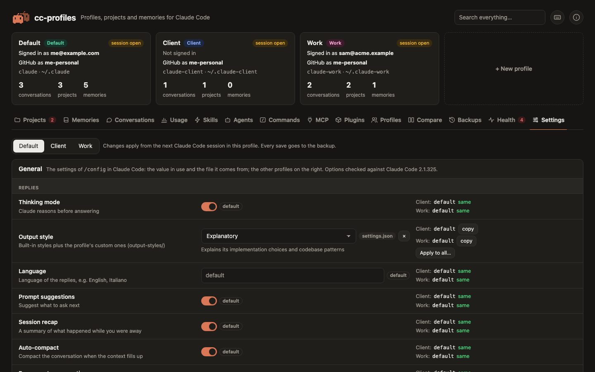

# Settings

The **Settings** tab edits one profile at a time; pick it at the top. Changes apply from the next Claude Code session in that profile, and every save goes to the backup.

<picture>
  <source media="not all" srcset="../assets/screenshots/settings-light.jpg">
  
</picture>

If a file is [shared](../concepts.md#sharing), a *shared with …* label warns that the change applies to every sharing profile.

## General

The same settings as the `/config` panel of Claude Code, in groups, plus two that `/config` does not have, with commit and pull request attribution as on/off switches.

| Setting | Key | Control |
|---|---|---|
| **Replies** | | |
| Thinking mode | `alwaysThinkingEnabled` | on/off, on by default |
| Output style | `outputStyle` | built-in styles plus the profile's custom styles in `output-styles/` |
| Language | `language` | free text |
| Prompt suggestions | `promptSuggestionEnabled` | on/off, on by default |
| Session recap | `awaySummaryEnabled` | on/off, on by default |
| Auto-compact | `autoCompactEnabled` ¹ | on/off, on by default |
| Precompute compaction | `precomputeCompactionEnabled` | on/off, on by default |
| Idle compaction | `idleCompaction` | on/off, on by default |
| Rewind code (checkpoints) | `fileCheckpointingEnabled` ¹ | on/off, on by default |
| Default permission mode | `permissions.defaultMode` | `default`, `plan`, `acceptEdits`, `auto`, `dontAsk` |
| Use auto mode during plan | `useAutoModeDuringPlan` | on/off, on by default |
| Artifacts | `enableArtifact` | on/off, on by default: off, Claude never publishes pages to claude.ai |
| **Interface** | | |
| Theme | `theme` ² | `auto`, `dark`, `light`, `dark-daltonized`, `light-daltonized`, `dark-ansi`, `light-ansi` |
| Show tips | `spinnerTipsEnabled` | on/off, on by default |
| Reduce motion | `prefersReducedMotion` | on/off |
| Verbose output | `verbose` ¹ | on/off |
| Terminal progress bar | `terminalProgressBarEnabled` ¹ | on/off, on by default |
| Show turn duration | `showTurnDuration` ¹ | on/off, on by default |
| Time format | `timeFormat` | `auto`, `12-hour`, `24-hour`, `24-hour-utc` |
| Default view | `defaultView` | `transcript`, `chat` |
| Auto-scroll | `autoScrollEnabled` ¹ | on/off, on by default |
| Show PR status footer | `prStatusFooterEnabled` ¹ | on/off, on by default |
| **Editor and files** | | |
| Editor mode | `editorMode` ² | `normal`, `vim` |
| Respect .gitignore in file picker | `respectGitignore` ¹ | on/off, on by default |
| Skip the /copy picker | `copyFullResponse` ¹ | on/off |
| Copy on select | `copyOnSelect` ¹ | on/off, on by default |
| Show last response in external editor | `externalEditorContext` ¹ | on/off |
| Diff tool | `diffTool` ¹ | `auto`, `terminal` |
| Auto-connect to IDE (external terminal) | `autoConnectIde` ¹ | on/off |
| Auto-install IDE extension | `autoInstallIdeExtension` ¹ | on/off, on by default |
| Worktree base ref | `worktree.baseRef` | `fresh`, `head` |
| **Voice** (claude.ai sign-in only; the same as `/voice`) | | |
| Voice mode | `voice.enabled` | on/off |
| How to talk | `voice.mode` | `hold` (default: hold the key while you talk), `tap` (tap to start, tap to stop and send) |
| Send on release | `voice.autoSubmit` | on/off: send the prompt when you release the key, with `hold` only |
| **Notifications and updates** | | |
| Notifications | `preferredNotifChannel` ¹ | `auto`, `iterm2`, `terminal_bell`, `iterm2_with_bell`, `kitty`, `ghostty`, `notifications_disabled` |
| Auto-update channel | `autoUpdatesChannel` | `latest`, `stable` |
| **Commits and pull requests** | | |
| Commit attribution | `attribution.commit` | on/off, on by default: off saves an empty text (no attribution), on removes the key; a custom text counts as on and is kept |
| Pull request attribution | `attribution.pr` | on/off, the same way |
| Co-authored-by in commits | `includeCoAuthoredBy` | shown only while a profile has it: deprecated by Claude Code, remove it with × |
| **Storage and hooks** (not in `/config`) | | |
| Keep conversations for (days) | `cleanupPeriodDays` | a whole number, 1 or more: Claude Code deletes older conversations when it starts; 30 when empty |
| Turn off all hooks | `disableAllHooks` | on/off: no hook runs, from settings files or plugins, and neither does the status line |

¹ Kept in the profile's `.claude.json`, as `/config` does, not in `settings.json`. Claude Code re-reads that file before it writes it, so a change made here is not lost; an open session picks it up when it restarts.
² Edited where a settings file already has it, otherwise in `.claude.json`, as `/config` does.

Settings that `/config` turns on by removing the key (Thinking mode, Prompt suggestions, Session recap, Artifacts) are removed here too when you turn them on, and so is **Turn off all hooks** when you turn it off. The model is picked with `/model` in Claude Code, so it is not listed here. Effort level and the renderer are not in `/config` either: edit them in the advanced editor.

Dropdowns list the values the Claude Code settings schema accepts. They were checked against the version shown in the tab. A value already in your file that is not in the list stays selectable as *(current value)*, so nothing is lost.

Changes in **General** are not saved one by one: each changed row is marked, and a bar at the bottom counts them, with **Cancel** and **Save changes**. Saving writes them all in one backup and keeps the page where it is. Switching profile or closing the page with unsaved changes asks first.

For each setting you see:

- **where the value comes from**: `settings.local.json` (amber, because it wins over `settings.json`), `settings.json`, `.claude.json`, or *default*. Saving writes to the file the value comes from, so a change is never hidden by a local override.
- **×** to go back to the default (the setting is removed when you save).
- **the other profiles' values**, with *copy* to take one.
- **Apply to all…**, when another profile has a different value: gives every other profile the value saved in this one.

### Apply a setting to every profile

**Apply to all…** first shows which profiles change (old value → new value, and the file) and which are skipped, with the reason:

- the profile already has that value;
- it shares the file with a profile that is already being changed (for example a shared `settings.json`);
- the value is not available there (a custom output style the profile does not have);
- its settings file has a JSON error.

Each profile is written where its value lives, as with a normal save. If the value is the default, the setting is removed wherever it is set. It is **one operation with one backup** covering every profile: one Restore in the Backups tab undoes it all.

## CLAUDE.md

`CLAUDE.md` in the profile folder holds global instructions, loaded at the start of **every** session in that profile. It is the right place for context that must always apply ("in this profile you work for …", conventions, tools to prefer). If it does not exist, saving creates it.

## Permissions

Rules in `settings.json`, one per line, in three lists:

- **allow**: run without asking
- **ask**: always ask
- **deny**: never allow

Precedence: `deny` wins over `ask`, which wins over `allow`. Examples:

```
Bash(npm run test:*)
Read(~/Documents/**)
mcp__claude_ai_Gmail
```

Other keys of `permissions` (such as `defaultMode`) are preserved. Rules in `settings.local.json` are shown as a count; edit them in the advanced editor.

**Add a rule to every profile…** adds one rule to one list (`allow`, `ask` or `deny`) in the `settings.json` of every profile. The confirmation lists the profiles that change and the ones skipped: those that already have the rule in that list, those sharing `settings.json` with a profile already changed, and those whose `settings.json` has an error. If a profile has the same rule in another list, the confirmation says so. One backup covers every profile.

## Hooks

Hooks are commands Claude Code runs on its own events: a formatter after every edit (`PostToolUse`), a notification when Claude needs you (`Notification`), a check before a session starts (`SessionStart`). The **Hooks** section lists those of `settings.json` and `settings.local.json`, one row each: the event, the matcher (*every* when empty), what it runs, its timeout, and the file it is in.

- **Add hook…** asks for the event (the list comes from Claude Code, with what each one is for), the matcher (suggestions follow the event: tool names for the tool events, `startup`, `resume`, `clear` and `compact` for `SessionStart`), the command, an optional timeout and status message, whether it runs in the background, and the file. A new hook joins the group with the same matcher, or starts a new one.
- **Edit** changes a command hook. Keys the form does not show (such as `shell` or `args`) stay as written. Changing the event, the matcher or the file moves the hook, and an event or a file left without hooks loses its `hooks` key.
- **Copy to…** and **Copy to all…** add the hook to the other profiles' `settings.json`. Profiles that already run the same hook for that event and matcher are skipped, and so are those sharing `settings.json` with a profile already changed. One backup covers every profile.
- **Delete** removes it. The file goes to the backup first.

Other hook types (`prompt`, `agent`, `http`, `mcp_tool`) are listed, copied and deleted here, and edited in the advanced editor. Hooks that installed plugins bring (their `hooks/hooks.json`) are listed under **From plugins**, read-only.

If the file changed after the page loaded it, for example because you edited it in an editor, an edit or a delete is refused with *reload and try again* instead of touching the wrong hook. cc-profiles never runs a hook. When **Turn off all hooks** is on, the section says so: none of them runs.

## Keyboard shortcuts

`keybindings.json` in the profile folder holds the shortcuts that `/keybindings` edits in Claude Code. The section lists the shortcuts it sets (context, keys, action, or *unbound* for `null`) and edits the file as JSON:

```json
{
  "bindings": [
    { "context": "Chat", "bindings": { "ctrl+e": "chat:externalEditor", "ctrl+g": "command:review", "ctrl+u": null } }
  ]
}
```

The file is checked as Claude Code checks it. A missing `bindings` list or an action that is not text or `null` cannot be saved. An unknown context, or a `command:` binding outside the Chat context, is saved with a warning, since Claude Code ignores only that binding. Without the file, Claude Code's default shortcuts apply, and saving creates it.

**Copy to…** and **Apply to all…** give other profiles this profile's saved file, replacing theirs (each one goes to the backup). **Remove file** goes back to the default shortcuts. Under the editor, each other profile shows how many shortcuts it sets, or *the same*.

## Advanced editor

Edits the whole `settings.json` or `settings.local.json`: hooks, `env`, `attribution`, and anything else. The JSON is checked as you type, **Format** re-indents it, **Save settings.json** (or **Save settings.local.json**) saves the file shown, and invalid JSON or a non-object cannot be saved.

## Global

`.claude.json` is mostly Claude Code's internal state (caches, counters, tips already seen) and is shown read-only. The only setting you can change here is **Auto-updates** (`autoUpdates`).

## Status line

Below General, **Status line** builds the line Claude Code shows under the prompt: tick the pieces, put them in order, pick brackets, separator and colors, and check the preview; or set your own command. See [Status line](../status-line.md).
